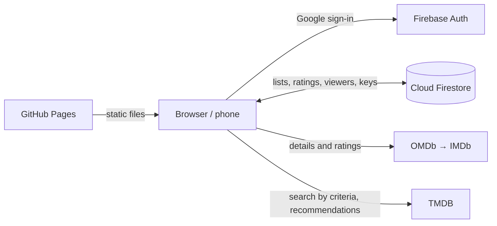

  <a href="README.md">🇧🇬 Български</a> · <b>🇬🇧 English</b>

  

<h1 align="center">What 2 Watch</h1>

  A family app for movies and series: what to watch, what we have watched, how much we liked it and what to put on next.
    
  <a href="https://velkoviv.github.io/w2w/"><b>Open the app →</b></a>

  
  
  
  
  

---

## Features

### Lists
- **To watch** — titles we are going to watch. Started ones are marked **▶ Watching** and stay on top until finished.
- **Watched** — finished titles. Titles can be moved manually in both directions.
- **Season counter** for series (`Season 2 / 4`).
- **New season** — once a day watched series are checked for a new season; if there is one, the series moves back to "To watch" automatically.

### Ratings and notes
- Ratings from **½★ to ★★★★★** (half stars included). ★★★ and up counts as "liked".
- A **comment** for every title.
- **Who watched it** — coloured initials on every card. The viewer list (by default Mariana, Ivaylo, Family) is managed in **Settings → Who watches**: add, rename and remove (up to 8 people), synced across devices.

### Search and discovery
- Add by title or IMDb link — details and ratings come from **IMDb**.
- **Discover** — titles are fetched automatically by criteria:
  keyword / franchise (e.g. *Star Wars*), genre, actor, director, **studio or platform** (Apple TV+, Disney+, Netflix, HBO…), minimum IMDb rating, years, language.
- Titles already in your lists are shown with a label of their category.
- Filters and sorting by actor, director, genre, rating, type, my rating and viewer.

### Recommendations
- **Because you liked…** — titles similar to the ones rated ★★★+, ordered by your taste.
- **Watch next** — your watch list ordered by the genres, directors and actors you like.
- Filter by viewer and separate **Movies** and **Series** sections.

### Everywhere
- Works on desktop and phone; installs as an app (PWA).
- **Google sign-in** and real-time sync between devices.
- **Български / English** — a switch with a flag in the menu (Bulgarian is the default). The choice is remembered per device.

### Interface
- **Side menu** that collapses to icons and opens on hover; with 📌 it stays open.
- Compact **stats**: watching now, titles in total, liked / disliked.
- The **header shrinks** while scrolling; on phones the filters open with a funnel button.

---

## How it works

No server and no build step — plain HTML, CSS and JavaScript, hosted on GitHub Pages.

| File | Purpose |
|---|---|
| `index.html` | Page structure |
| `styles.css` | Dark theme, responsive layout, compact header on scroll |
| `app.js` | All the logic: lists, ratings, viewers, search, recommendations |
| `i18n.js` | Interface translations (Bulgarian and English) |
| `cloud.js` | Google sign-in and Firestore sync |
| `firebase-config.js` | Public Firebase project configuration and allowed accounts |
| `firestore.rules` | Database access rules |
| `sw.js`, `manifest.webmanifest`, `icon-*.png` | App installation and offline cache |
| `logo-mark.png`, `favicon-64.png` | The W mark for the menu and the browser tab |

---

## Security

- Data access is controlled by [`firestore.rules`](firestore.rules): only the listed Google accounts with a verified email can read and write.
- The `apiKey` in `firebase-config.js` is **public by design** — it only identifies the project. The key is restricted to the site's domain in Google Cloud Console.
- The OMDb and TMDB keys are **not in the code** — they are stored in Firestore behind the access rules (together with the viewer list).
- Local files with secrets (`*.txt`) are excluded via `.gitignore`.

---

## Setting up from scratch

1. **API keys** (free)
   - OMDb: <https://www.omdbapi.com/apikey.aspx>
   - TMDB: <https://www.themoviedb.org/settings/api>
2. **Firebase** — <https://console.firebase.google.com>
   - Authentication → Sign-in method → **Google** → Enable
   - Firestore Database → Create (production mode) → Rules → paste [`firestore.rules`](firestore.rules) with your emails → Publish
   - Project settings → Your apps → Web → copy `firebaseConfig` into [`firebase-config.js`](firebase-config.js) (`ALLOWED_EMAILS` is optional — left empty so the emails are not public)
   - Authentication → Settings → Authorized domains → add `<user>.github.io`
3. **GitHub Pages** — Settings → Pages → Deploy from branch → `main` / `root`.
4. Open the site, sign in with Google and enter the OMDb and TMDB keys in **Settings** (once — they sync to all devices).

### Locally
Open `index.html` directly in the browser — the app works without the cloud, on this device only. Google sign-in needs the site to be opened over `http(s)`.

---

## Installing on a phone

| iPhone (Safari) | Android (Chrome) |
|---|---|
| Share → **Add to Home Screen** | ⋮ → **Install app** |

---

  Data: <a href="https://www.imdb.com">IMDb</a> via <a href="https://www.omdbapi.com">OMDb API</a> ·
  <a href="https://www.themoviedb.org">TMDB</a>
   
  This product uses the TMDB API but is not endorsed or certified by TMDB.

