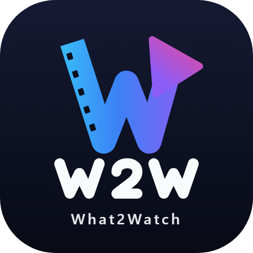
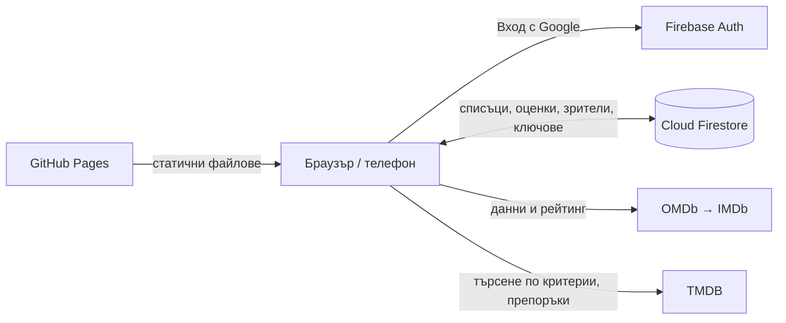

  <b>🇧🇬 Български</b> · <a href="README.en.md">🇬🇧 English</a>

  

<h1 align="center">What 2 Watch</h1>

  Семейно приложение за филми и сериали: какво да гледаме, какво сме гледали, как ни е харесало и какво да пуснем следващо.
    
  <a href="https://velkoviv.github.io/w2w/"><b>Отвори приложението →</b></a>

  
  
  
  
  

---

## Възможности

### Списъци
- **За гледане** — заглавия, които предстои да гледаме. Започнатите са отбелязани с **▶ Гледам** и стоят най-отгоре, докато не ги завършим.
- **Гледани** — завършените заглавия. Може да се местят ръчно и в двете посоки.
- **Брояч на сезони** при сериалите (`Сезон 2 / 4`).
- **Нов сезон** — веднъж на ден се проверява дали гледан сериал има нов сезон; ако има, се връща автоматично в „За гледане“.

### Оценки и бележки
- Оценка от **½★ до ★★★★★** (с половинки). ★★★ и повече се счита за „харесано“.
- **Коментар** към всяко заглавие.
- **Кой е гледал** — цветни инициали на всяка карта. Списъкът със зрители (по подразбиране Мариана, Ивайло, Семейно) се управлява в **Настройки → Кой гледа**: добавяне, преименуване и премахване (до 8 души), синхронизирано между устройствата.

### Търсене и откриване
- Добавяне по заглавие или IMDb линк — данните и рейтингът идват от **IMDb**.
- **Открий** — автоматично сваляне на заглавия по критерии:
  ключова дума / поредица (напр. *Star Wars*), жанр, актьор, режисьор, **студио или платформа** (Apple TV+, Disney+, Netflix, HBO…), минимален IMDb рейтинг, години, език.
- Заглавия, които вече са в списъците, се показват с етикет на категорията.
- Филтри и сортиране по актьор, режисьор, жанр, рейтинг, тип, оценка, зрител.

### Препоръки
- **Защото харесахте…** — подобни заглавия на оценените с ★★★+, подредени по вкуса ни.
- **Гледайте следващо** — подреждане на списъка за гледане според харесаните жанрове, режисьори и актьори.
- Филтър по зрител и разделяне на **Филми** и **Сериали**.

### Навсякъде
- Работи на компютър и телефон; инсталира се като приложение (PWA).
- **Вход с Google** и синхронизация в реално време между устройствата.
- **Български / English** — превключвател с флаг в менюто (българският е по подразбиране). Изборът се помни за всяко устройство.

### Интерфейс
- **Странично меню**, което се свива до иконки и се отваря при посочване; с 📌 може да остане отворено.
- Компактна **статистика**: гледам в момента, заглавия общо, харесани / нехаресани.
- **Хедърът се смалява** при скролиране; на телефон филтрите се отварят с бутон-фунийка.

---

## Как работи

Няма сървър и няма build стъпка — чист HTML, CSS и JavaScript, хостнати в GitHub Pages.

| Файл | Роля |
|---|---|
| `index.html` | Структура на интерфейса |
| `styles.css` | Тъмна тема, адаптивен дизайн, компактен хедър при скрол |
| `app.js` | Цялата логика: списъци, оценки, зрители, търсене, препоръки |
| `i18n.js` | Преводи на интерфейса (български и английски) |
| `cloud.js` | Вход с Google и синхронизация с Firestore |
| `firebase-config.js` | Публична конфигурация на Firebase проекта и разрешени акаунти |
| `firestore.rules` | Правила за достъп до базата |
| `sw.js`, `manifest.webmanifest`, `icon-*.png` | Инсталиране като приложение и офлайн кеш |
| `logo-mark.png`, `favicon-64.png` | Знакът (W) за менюто и таба на браузъра |

---

## Сигурност

- Достъпът до данните се контролира от [`firestore.rules`](firestore.rules): само изброените Google акаунти с потвърден имейл могат да четат и пишат.
- `apiKey` във `firebase-config.js` е **публичен по замисъл** — той само идентифицира проекта. Ключът е ограничен до домейна на сайта в Google Cloud Console.
- Ключовете за OMDb и TMDB **не са в кода** — пазят се в Firestore зад правилата за достъп (заедно със списъка със зрители).
- Локални файлове с тайни (`*.txt`) са изключени чрез `.gitignore`.

---

## Настройка от нулата

1. **API ключове** (безплатни)
   - OMDb: <https://www.omdbapi.com/apikey.aspx>
   - TMDB: <https://www.themoviedb.org/settings/api>
2. **Firebase** — <https://console.firebase.google.com>
   - Authentication → Sign-in method → **Google** → Enable
   - Firestore Database → Create (production mode) → Rules → поставете [`firestore.rules`](firestore.rules) с вашите имейли → Publish
   - Project settings → Your apps → Web → копирайте `firebaseConfig` във [`firebase-config.js`](firebase-config.js) (`ALLOWED_EMAILS` е по желание — празен, за да не са публични имейлите)
   - Authentication → Settings → Authorized domains → добавете `<потребител>.github.io`
3. **GitHub Pages** — Settings → Pages → Deploy from branch → `main` / `root`.
4. Отворете сайта, влезте с Google и въведете OMDb и TMDB ключовете в **Настройки** (веднъж — синхронизират се към всички устройства).

### Локално
Отворете `index.html` директно в браузъра — приложението работи без облак, само на това устройство. Входът с Google изисква сайтът да е отворен през `http(s)`.

---

## Инсталиране на телефон

| iPhone (Safari) | Android (Chrome) |
|---|---|
| Сподели → **Добави към началния екран** | ⋮ → **Инсталирай приложението** |

---

  Данни: <a href="https://www.imdb.com">IMDb</a> чрез <a href="https://www.omdbapi.com">OMDb API</a> ·
  <a href="https://www.themoviedb.org">TMDB</a>
   
  This product uses the TMDB API but is not endorsed or certified by TMDB.

